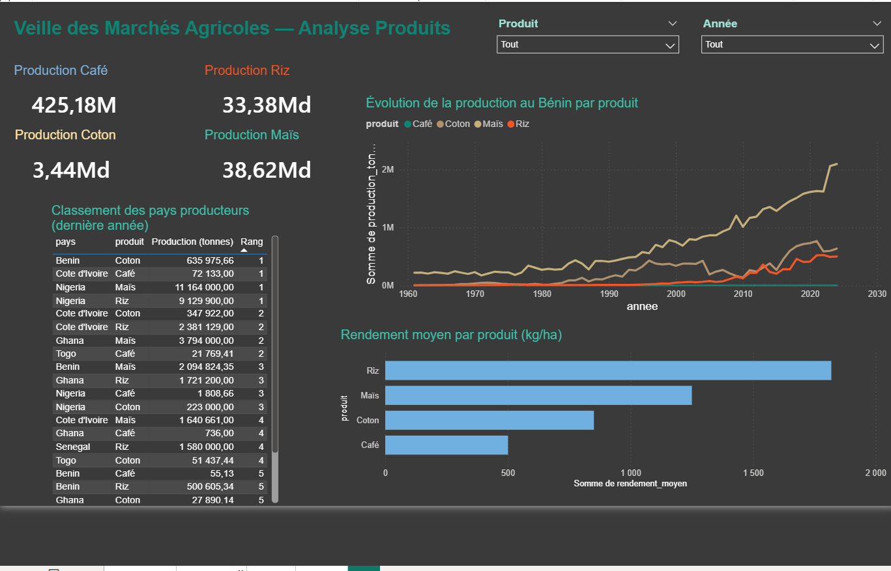
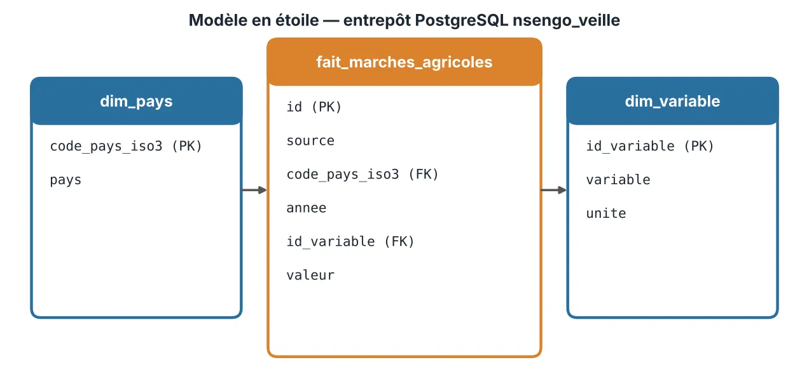

# Veille des marchés agricoles — NSENGO (preuve de concept)

> 

**Objectif :** suivre l'évolution des prix et de la production agricole en Afrique de l'Ouest
pour aider la direction à décider (quels produits et quels pays surveiller, où se situent
les risques de volatilité et de dépendance aux importations).

Plateforme décisionnelle de veille des marchés agricoles construite à partir de
**données ouvertes** (FAOSTAT, Banque mondiale). Projet réalisé dans le cadre d'un
stage Data Analyst chez NSENGO. Aucune donnée interne de l'entreprise n'est utilisée.

**Stack :** Python, pandas, PostgreSQL, Power BI.
**Prérequis :** Python 3, PostgreSQL, Power BI Desktop ; dépendances Python : `pip install -r 02_Collecte_donnees/requirements.txt`.

## Résultats clés (période 2014–2024)

- **Maïs au Bénin : production +54,7 %** (1,35 → 2,09 M t), mais le **rendement le plus faible**
  des six pays étudiés (1 190 kg/ha contre 2 814 au Sénégal) : la hausse vient des surfaces, pas de la productivité.
- **Coton au Bénin : +66,6 %** (382 → 636 kt) avec une forte volatilité (−29,5 % en 2015, −23,3 % en 2022).
- **Balance commerciale 2024 négative** pour le maïs (−3,3 M USD) et le riz (−0,8 M USD) :
  dépendance aux importations. Prix mondiaux à l'export : café +43,9 %, riz −15,9 %, maïs −3,2 %.

Détail des 9 constats et des 6 recommandations : `08_Analyse_recommandations/analyse_recommandations.md`.

## Sources de données

- [FAOSTAT](https://www.fao.org/faostat/) : production et commerce, séries 1961–2024.
- [Banque mondiale](https://data.worldbank.org/) : indicateurs macroéconomiques (inflation, etc.).
- Périmètre : Bénin, Côte d'Ivoire, Ghana, Nigeria, Sénégal, Togo (+ agrégat Monde) ;
  produits : café, coton, maïs, riz.

## Architecture (ETL)

Collecte (Python) → Préparation (Python / pandas) → Base PostgreSQL (modèle en étoile)
→ Vues SQL de KPI → Restitution (Power BI)



## Avancement par phase

| Phase | Dossier | État |
|---|---|---|
| 1. Analyse | `01_Cadrage/` | Fait (cahier des charges) |
| 2. Collecte | `02_Collecte_donnees/` | Fait : World Bank et FAOSTAT (autres sources à venir) |
| 3. Préparation / ETL | `03_Preparation_donnees/` | Fait |
| 4. Base PostgreSQL | `04_Base_PostgreSQL/` | Fait (schéma + chargement) |
| 5. Indicateurs SQL | `05_KPI_SQL/` | Fait (10 vues) |
| 6. Restitution Power BI | `06_Restitution_PowerBI/` | Fait (4 pages : Direction, Produits, Prix, Pays) |
| 7. Documentation (dictionnaire, guide utilisateur) | `07_Documentation/` | Fait |
| 8. Analyse et recommandations | `08_Analyse_recommandations/` | Fait (analyse chiffrée, 9 constats, 6 recommandations) |

Chaque dossier contient son propre `README.md` (installation, utilisation, tests).

## Ordre d'exécution

```bash
# 02 : télécharger les données brutes
python -m nsengo_veille.run_collecte --sources all
# 03 : nettoyer et transformer
python -m nsengo_prepare.run_preparation
# 04 : créer le schéma et charger la base (copier .env.example en .env)
python -m nsengo_charge.run_chargement
# 05 : créer les vues KPI
python run_vues.py
```

Voir les README de chaque dossier pour les options exactes.

## Configuration

Les identifiants PostgreSQL se placent dans un fichier `.env` (modèle : `.env.example`),
jamais versionné.

## Auteur

Mourad SAIZONOU — ESIGELEC, dominante Big Data pour la Transformation Numérique.  
LinkedIn : [Mourad SAIZONOU](https://www.linkedin.com/in/mourad-saizonou-bab131272/)
